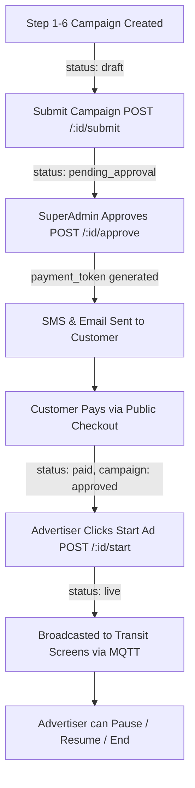

# Advertiser Portal — API Documentation (Commercial Campaigns & Operations)

> **Role:** `ROLE-ADVERTISER` (VMOVEXA Internal Staff / Campaign Operations Manager)  
> **Base Path:** `http://localhost:4000/api/v1`  
> **Auth:** Staff endpoints require `Authorization: Bearer <token>`  
> **Public Endpoints:** Customer Checkout (`/campaigns/:id/public-*`) & QR Scan (`/qr/*`) require NO auth (secured by secret tokens/codes).

---

## 📋 Complete Endpoints Summary (38 APIs)

### 1. Campaign Core CRUD (6 APIs)
| Method | Endpoint | Auth | Description |
|--------|----------|------|-------------|
| `GET` | `/campaigns` | Yes | List campaigns (scoped to advertiser's clients, with filters & pagination) |
| `GET` | `/campaigns/:id` | Yes | Detailed campaign record with media assets, client info & schedule |
| `POST` | `/campaigns` | Yes | Create campaign (Step 1-6 complete payload with media array) |
| `PUT` | `/campaigns/:id` | Yes | Full update of draft campaign |
| `PATCH` | `/campaigns/:id` | Yes | Partial update of campaign details |
| `DELETE` | `/campaigns/:id` | Yes | Delete draft campaign |

### 2. Campaign Lifecycle Controls (10 APIs)
| Method | Endpoint | Auth | Description |
|--------|----------|------|-------------|
| `POST` | `/campaigns/:id/submit` | Yes | Submit draft campaign for SuperAdmin approval (`pending_approval`) |
| `POST` | `/campaigns/:id/approve` | Yes | SuperAdmin approve campaign (generates customer payment token) |
| `POST` | `/campaigns/:id/reject` | Yes | Reject campaign with feedback remarks |
| `POST` | `/campaigns/:id/verify` | Yes | Verify campaign creative assets compliance |
| `POST` | `/campaigns/:id/pay` | Yes | Internal checkout initiation |
| `POST` | `/campaigns/:id/pay/confirm` | Yes | Confirm payment (Razorpay payment_id & signature) |
| `POST` | `/campaigns/:id/start` | Yes | **Start Ad:** Broadcast creatives to transit bus screens (`status: live`) |
| `POST` | `/campaigns/:id/pause` | Yes | Temporarily pause broadcast (`status: paused`) |
| `POST` | `/campaigns/:id/end` | Yes | Terminate campaign broadcast (`status: completed`) |
| `POST` | `/campaigns/:id/share-payment-link` | Yes | Re-dispatch SMS/Email payment link to customer |

### 3. Campaign Telemetry & Analytics (9 APIs)
| Method | Endpoint | Auth | Description |
|--------|----------|------|-------------|
| `GET` | `/campaigns/:id/analytics` | Yes | Specific campaign impressions, plays, reach & route coverage |
| `GET` | `/campaigns/:id/reviews` | Yes | Feedback & star ratings submitted by transit passengers via QR scan |
| `GET` | `/campaigns/analytics/overview`| Yes | Global advertiser portfolio impression counts & screen play stats |
| `GET` | `/campaigns/fleet-options` | Yes | Available fleets & transit buses with digital screens |
| `GET` | `/campaigns/mqtt-status` | Yes | Real-time MQTT screen broker connection health |
| `GET` | `/campaigns/slots/availability` | Yes | Check screen ad slot availability for selected dates/routes |
| `GET` | `/campaigns/tracking/live` | Yes | Live bus positions currently broadcasting this campaign |
| `GET` | `/campaigns/tracking/routes`| Yes | Transit route corridors covered by the campaign |
| `GET` | `/campaigns/analytics` | Yes | Summary analytics alias |

### 4. Public Customer Checkout (No Login Required) (4 APIs)
| Method | Endpoint | Auth | Description |
|--------|----------|------|-------------|
| `GET` | `/campaigns/:id/public-checkout` | **Token** | Customer views invoice, campaign details & payment amount |
| `GET` | `/campaigns/:id/public-invoice` | **Token** | Render/Download printable HTML Tax Invoice |
| `POST` | `/campaigns/:id/public-order` | **Token** | Create Razorpay order for online payment |
| `POST` | `/campaigns/:id/public-pay` | **Token** | Process payment callback & confirm Razorpay signature |

### 5. Public Passenger QR Engagement (4 APIs)
| Method | Endpoint | Auth | Description |
|--------|----------|------|-------------|
| `GET` | `/qr/:code` | No | Log passenger QR scan telemetry & redirect to campaign landing |
| `GET` | `/qr/scan/:code` | No | Scan tracking alias |
| `GET` | `/qr/scan/:code/landing` | No | Passenger landing page info & feedback form |
| `POST` | `/qr/:code/review` | No | Passenger submit star rating & review for the ad/brand |

### 6. Client Directory Management (5 APIs)
| Method | Endpoint | Auth | Description |
|--------|----------|------|-------------|
| `GET` | `/advertisers` | Yes | List external client businesses (e.g. Sharma Traders, Tata Motors) |
| `GET` | `/advertisers/:id` | Yes | Client profile, billing address, contact person & campaign history |
| `POST` | `/advertisers` | Yes | Register a new client profile |
| `PATCH` | `/advertisers/:id` | Yes | Update client profile |
| `PATCH` | `/advertisers/:id/status` | Yes | Toggle client active/inactive status |

---

## 🔄 BUSINESS LIFECYCLE & VMOVEXA RULES

> [!IMPORTANT]
> 1. **Advertiser is a VMOVEXA Employee:** Creates campaigns on behalf of external brands/clients.
> 2. **Multi-Media Files:** When selecting files, frontend must create instant local blob previews. Upload to `/uploads` happens during campaign submission.
> 3. **Manual Ad Launch:** After payment, campaign does NOT start automatically. The VMOVEXA Advertiser clicks **"Start Ad"** (`POST /:id/start`) to launch creatives to screens.



---

## 📦 SECTION 1: Campaign Creation (Step 1-6 JSON)

### 1.1 POST `/campaigns`
Creates campaign in `draft` status with full multi-media asset attachments.

#### Request Body
```json
{
  "title": "Diwali Mega Sale 2026 - Sharma Electronics",
  "client_name": "Sharma Electronics Pvt Ltd",
  "client_company": "Sharma Group",
  "client_phone": "9827011223",
  "client_email": "marketing@sharmaelectronics.com",
  "client_city": "Indore",
  "client_address": "45 M.G. Road, Indore, MP",
  "type": "commercial", // "commercial", "psa", "government"
  "start_date": "2026-10-15",
  "end_date": "2026-10-30",
  "daily_slot_seconds": 30,
  "daily_frequency": 120, // 120 plays per bus per day
  "target_fleets": ["flt_01HX...", "flt_01HY..."],
  "target_routes": ["rt_01HX...", "rt_01HY..."],
  "total_budget": 85000.00,
  "tax_amount": 15300.00, // 18% GST
  "final_amount": 100300.00,
  "media": [
    {
      "media_type": "video", // "video", "image", "html"
      "file_url": "http://localhost:4000/uploads/campaigns/diwali-ad-30s.mp4",
      "duration_seconds": 30,
      "aspect_ratio": "16:9",
      "resolution": "1920x1080",
      "title": "Main 30s Video Spot"
    },
    {
      "media_type": "image",
      "file_url": "http://localhost:4000/uploads/campaigns/diwali-banner.jpg",
      "duration_seconds": 10,
      "aspect_ratio": "16:9",
      "title": "Static L-Band Banner"
    }
  ]
}
```

#### Success Response `201`
```json
{
  "success": true,
  "message": "Campaign draft created successfully.",
  "data": {
    "id": "cmp_01HX98...",
    "title": "Diwali Mega Sale 2026 - Sharma Electronics",
    "status": "draft",
    "payment_status": "unpaid",
    "created_at": "2026-10-10T06:00:00.000Z"
  }
}
```

---

## 💳 SECTION 2: Public Customer Payment Checkout

### 2.1 GET `/campaigns/:id/public-checkout?token=...`
Unauthenticated customer invoice view.

#### Query Params
- `token` (Required): Secret payment token sent to customer's SMS/Email.

#### Success Response `200`
```json
{
  "success": true,
  "data": {
    "campaign_id": "cmp_01HX98...",
    "title": "Diwali Mega Sale 2026 - Sharma Electronics",
    "client_name": "Sharma Electronics Pvt Ltd",
    "client_email": "marketing@sharmaelectronics.com",
    "duration_days": 15,
    "buses_count": 25,
    "total_impressions_est": 350000,
    "base_amount": 85000.00,
    "gst_amount": 15300.00,
    "total_amount": 100300.00,
    "payment_status": "unpaid",
    "razorpay_key_id": "rzp_test_..."
  }
}
```

---

### 2.2 POST `/campaigns/:id/public-pay?token=...`
Process Razorpay payment signature verification.

#### Request Body
```json
{
  "razorpay_payment_id": "pay_OXYZ123456",
  "razorpay_order_id": "order_OXYZ123456",
  "razorpay_signature": "9a38f4d7b..."
}
```

#### Success Response `200`
```json
{
  "success": true,
  "message": "Payment verified successfully. Tax invoice generated.",
  "data": {
    "payment_status": "paid",
    "transaction_id": "txn_01HX...",
    "invoice_url": "/campaigns/cmp_01HX98.../public-invoice?token=..."
  }
}
```

---

## 💻 Standard Frontend Service Implementation

```javascript
// src/api/services/advertiser.service.js
import apiClient from '../client';

export const advertiserService = {
  // Campaigns
  getCampaigns: (params) => apiClient.get('/campaigns', { params }),
  getCampaignById: (id) => apiClient.get(`/campaigns/${id}`),
  createCampaign: (data) => apiClient.post('/campaigns', data),
  updateCampaign: (id, data) => apiClient.patch(`/campaigns/${id}`, data),
  submitCampaign: (id) => apiClient.post(`/campaigns/${id}/submit`),
  startCampaign: (id) => apiClient.post(`/campaigns/${id}/start`),
  pauseCampaign: (id) => apiClient.post(`/campaigns/${id}/pause`),
  endCampaign: (id) => apiClient.post(`/campaigns/${id}/end`),
  sharePaymentLink: (id) => apiClient.post(`/campaigns/${id}/share-payment-link`),

  // Analytics & Availability
  getAnalytics: (id) => apiClient.get(`/campaigns/${id}/analytics`),
  getSlotAvailability: (params) => apiClient.get('/campaigns/slots/availability', { params }),
  getLiveTracking: () => apiClient.get('/campaigns/tracking/live'),

  // Clients Directory
  getClients: (params) => apiClient.get('/advertisers', { params }),
  getClientById: (id) => apiClient.get(`/advertisers/${id}`),
  createClient: (data) => apiClient.post('/advertisers', data),
};
```

---

## 🔗 Frontend Architecture & File Reference
- **Services:** `src/api/services/advertiser/` (`campaign.service.js`, `advertiser.service.js`)
- **Thunks:** `src/store/thunks/advertiser/` (`campaign.thunks.js`, `advertiser.thunks.js`)
- **Slices:** `src/store/slices/advertiser/` (`campaignSlice.js`, `advertiserSlice.js`)
- **Custom Hooks:** `src/hooks/advertiser/` (`useCampaign.js`, `useAdvertiser.js`)
- **Pages:** `src/pages/advertiser/` (`CampaignsPage.jsx`, `CreateCampaignPage.jsx`, `AdvertiserDashboard.jsx`)
- **Public Checkout Page:** `src/pages/public/PublicCheckoutPage.jsx` (`/campaigns/:id/pay?token=...`)
- **Integration Blueprint:** See [FRONTEND_INTEGRATION_GUIDE.md](file:///e:/vmovexa/application_api_doc/FRONTEND_INTEGRATION_GUIDE.md)

