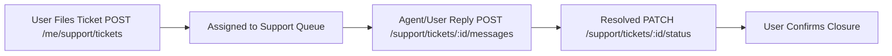

# Common Shared Services — API Documentation (Uploads, Support, Content, i18n & Geocoding)

> **Base Path:** `http://localhost:4000/api/v1`  
> **Auth:** All endpoints require `Authorization: Bearer <token>` (except public i18n bundle and static assets)  
> **Scope:** Shared cross-domain services utilized by multiple user roles.

---

## 📋 Complete Endpoints Summary (23 APIs)

### 1. File & Media Uploads (`/uploads`) (4 APIs)
| Method | Endpoint | Description |
|--------|----------|-------------|
| `POST` | `/uploads` | Universal multipart file upload (image, logo, document) |
| `POST` | `/uploads/media` | Multipart upload for campaign ads (Videos, Banners, PDFs, Images). Max 500MB |
| `POST` | `/uploads/document` | Upload compliance KYC docs (Driver license, Vehicle RC, Insurance) |
| `POST` | `/uploads/video` | High-bandwidth transit ad video upload with ffmpeg validation |

### 2. Helpdesk & Support Tickets (`/support` & `/me/support`) (5 APIs)
| Method | Endpoint | Description |
|--------|----------|-------------|
| `GET` | `/me/support/tickets` | List support tickets filed by current logged-in user |
| `POST` | `/me/support/tickets` | File a new support ticket (Subject, Category, Severity, Description) |
| `GET` | `/support/tickets/:id` | Get ticket conversation & messages |
| `POST` | `/support/tickets/:id/messages`| Post reply in ticket thread |
| `PATCH`| `/support/tickets/:id/status` | Update ticket status (`open`, `in_progress`, `resolved`, `closed`) |

### 3. Dynamic Content, Runbooks & FAQs (`/content`) (4 APIs)
| Method | Endpoint | Description |
|--------|----------|-------------|
| `GET` | `/content/:type` | Fetch dynamic role content (e.g. `/content/help?role=ROLE-TENANT-ADMIN`) |
| `GET` | `/content/faqs` | List role-based interactive FAQs with live search |
| `POST` | `/content` | SuperAdmin create dynamic content guide/runbook |
| `POST` | `/content/:id/publish` | Publish / release content revision |

### 4. Reports & Data Exports (`/reports` & `/exports`) (4 APIs)
| Method | Endpoint | Description |
|--------|----------|-------------|
| `GET` | `/reports` | List generated analytics reports |
| `POST` | `/reports/generate` | Request on-demand report generation |
| `GET` | `/exports` | List historical export jobs |
| `POST` | `/exports` | Trigger CSV / Excel / PDF data export |

### 5. Google Maps & Geocoding Telematics Proxy (`/google-apis`) (3 APIs)
| Method | Endpoint | Description |
|--------|----------|-------------|
| `GET` | `/google-apis/geocode` | Address to GPS coordinates resolution |
| `GET` | `/google-apis/routes` | Compute shortest route path & travel time between transit stops |
| `GET` | `/google-apis/places` | Real-time search suggestions for transit depots and bus stops |

### 6. Multi-Language & i18n (`/i18n`) (3 APIs)
| Method | Endpoint | Description |
|--------|----------|-------------|
| `GET` | `/i18n/:lang` | Fetch localized UI strings bundle (supports 10 Indian languages) |
| `GET` | `/i18n/languages` | List all registered languages |
| `POST` | `/i18n/auto-translate` | AI/Cloud auto-translation of UI string master keys |

---

## 📁 SECTION 1: File Uploads Integration

### 1.1 POST `/uploads/media`
Multipart upload endpoint for campaign ad creatives.

#### Request Headers
```http
Content-Type: multipart/form-data
Authorization: Bearer <token>
```

#### FormData Payload
- `file`: Binary file (MP4, WEBM, JPG, PNG, PDF)
- `category`: `campaign_media` (or `avatar`, `kyc`)

#### Success Response `201`
```json
{
  "success": true,
  "message": "File uploaded successfully.",
  "data": {
    "file_id": "upl_01HX99...",
    "original_filename": "diwali_sale_spot.mp4",
    "mime_type": "video/mp4",
    "size_bytes": 14502000,
    "url": "http://localhost:4000/uploads/campaigns/diwali_sale_spot.mp4",
    "duration_seconds": 30,
    "resolution": "1920x1080"
  }
}
```

---

## 🎫 SECTION 2: Support Ticket Lifecycle



### 2.1 POST `/me/support/tickets`
```json
{
  "subject": "GPS Tracker offline for vehicle MP09-CV-2024",
  "category": "HARDWARE",
  "priority": "HIGH",
  "description": "Device stopped sending telemetry since 08:30 AM today near Palasia square."
}
```

---

## 💻 Standard Frontend Service

```javascript
// src/api/services/common.service.js
import apiClient from '../client';
import ENDPOINTS from '../endpoints';

export const commonService = {
  // File Uploads
  uploadMedia: (formData, onProgress) =>
    apiClient.post(ENDPOINTS.UPLOADS.CREATE, formData, {
      headers: { 'Content-Type': 'multipart/form-data' },
      onUploadProgress: onProgress,
    }),

  // Support Tickets
  getMyTickets: (params) => apiClient.get(ENDPOINTS.SUPPORT.MY_TICKETS, { params }),
  createTicket: (data) => apiClient.post(ENDPOINTS.SUPPORT.MY_TICKETS, data),
  getTicketDetails: (id) => apiClient.get(ENDPOINTS.SUPPORT.TICKET_ONE(id)),
  replyTicket: (id, data) => apiClient.post(ENDPOINTS.SUPPORT.TICKET_MESSAGES(id), data),
  updateTicketStatus: (id, status) => apiClient.patch(ENDPOINTS.SUPPORT.TICKET_STATUS(id), { status }),

  // Dynamic Content & Help
  getContentPage: (type, params) => apiClient.get(ENDPOINTS.CONTENT.PAGE(type), { params }),
  getFaqs: (params) => apiClient.get(ENDPOINTS.CONTENT.FAQS, { params }),

  // i18n Translations
  getLanguageBundle: (lang) => apiClient.get(ENDPOINTS.I18N.BUNDLE(lang)),
};
```

---

## 🔗 Architecture & File Reference
- **Components:** `src/components/ui/CreateTicketModal.jsx`, `src/components/content/RoleHelpPage.jsx`
- **Context:** `src/contexts/I18nContext.jsx` (seeded with 276 master keys & 10 Indian languages)
- **Service:** `src/api/services/i18n.service.js`, `src/api/services/upload.service.js`
- **Integration Blueprint:** See [FRONTEND_INTEGRATION_GUIDE.md](../FRONTEND_INTEGRATION_GUIDE.md)
